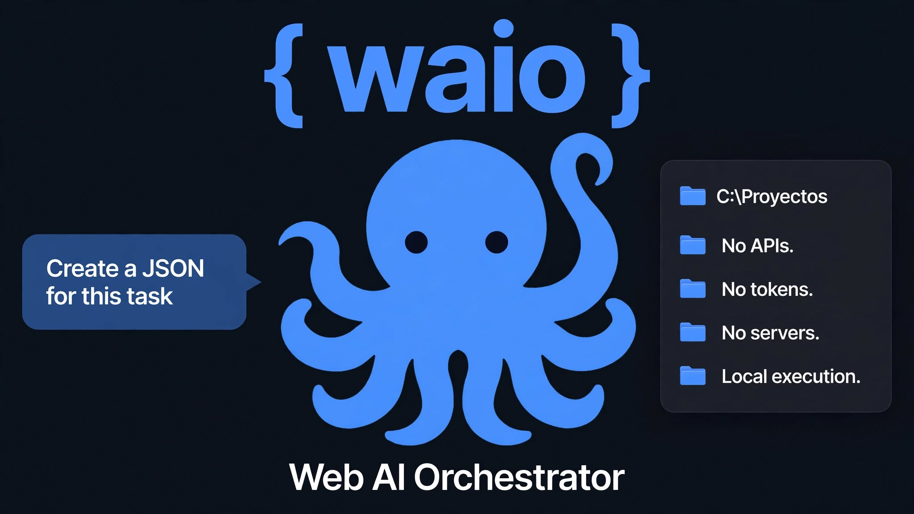

# 🐙 {waio}

**Dale manos a tu IA web.**

**Read this in:** [English](README.md) | [Español](README.es.md) | [中文](README.zh.md)

---

## 💡 ¿Qué es WAIO?

WAIO (Web AI Orchestrator) es un motor local **súper liviano** que le da **manos y ojos** a las IAs web (DeepSeek, ChatGPT, Gemini, Claude). 

Las IAs son increíblemente inteligentes, pero están encerradas en el navegador: no pueden leer tus archivos, no pueden organizar tus carpetas y no pueden ejecutar comandos. **WAIO rompe esa barrera.** La IA genera un JSON, WAIO lo detecta, lo ejecuta en tu PC y le devuelve los resultados. 

Sin APIs. Sin tokens. Sin servidores. Sin nube. Todo ocurre en tu máquina.

> *"WAIO nació de una necesidad simple: darle a una IA web un dedo para tocar mi PC. Un comando. Una acción. Pero creció. Hoy es un pulpo: 26 skills, 21 comandos, 4 perfiles de seguridad, voz, HTML, ZIP, PDF, Word, Excel. Todo sin APIs."*

🎥 **[Ver el video demostrativo en YouTube](https://youtu.be/FkuZu94az3A)** | 📺 **[Suscribirse al canal](https://www.youtube.com/@waio_dev)**

### ⚠️ NOTAS TÉCNICAS DE LA DEMO
- La prueba del video fue realizada utilizando el perfil de seguridad **`advanced`** (necesario para ejecutar scripts y abrir el navegador). Este perfil no es recomendable para usuarios novatos.
- Para agilizar la grabación, se utilizó un plugin de descarga automática para los archivos JSON. Dicho plugin es de uso interno para esta demo y **NO está incluido** en el repositorio público de esta versión.

---

## ⚡ Características de la versión 3.3 "Deliberado"

WAIO está diseñado para ser robusto, seguro y **extremadamente ligero**. No necesita una supercomputadora; corre sin problemas en procesadores antiguos (como un Intel i3 de 3ª gen, AMD Athlon o Dual Core de 1.6 GHz con 4 GB de RAM). El único límite real es el navegador que uses para la IA.

- **Bilingüe por diseño (Human & AI Friendly):** No necesitas hablar español para usar WAIO. Los comandos base tienen alias en inglés y en formato Linux (`ls`, `cat`, `rm`, `mv`, `mkdir`, `grep`). Podés hablarle a la IA en inglés y ella generará el JSON con los comandos correctos. WAIO los ejecutará sin problema.
- **Sistema de Skills (26 skills):** Capacidades extensibles que la IA descubre y usa sola. Desde leer PDFs, crear Excel/Word, comprimir ZIPs, hasta controlar el volumen y hablar por voz.
- **Perfiles de Seguridad (4 niveles):** `readonly` (solo lectura, ideal para dar contexto), `standard` (por defecto, todo va a la papelera), `advanced` (ejecución de scripts y skills), `debug` (acceso total para rescate y pruebas críticas).
- **Timeout Configurable:** Protección contra bloqueos. La IA puede reintentar tareas largas (como procesar un PDF pesado) sin romper el motor.
- **Sandbox por Carpeta:** Hacés clic derecho en cualquier carpeta (o pendrive), iniciás WAIO, y esa carpeta se convierte en el sandbox. Nada de carpetas fijas en el sistema.
- **Voz Integrada:** Para accesibilidad y para que la IA te explique paso a paso lo que está haciendo.
- **Doble Hilo (Motor v3.3):** El motor ya no se cuelga si un JSON es inválido o malicioso. Procesa en cola.
- **0 Dependencias Obligatorias:** El núcleo usa Python estándar. Solo necesitas `send2trash` (opcional) para la papelera de reciclaje.

---

## 🚀 Instalación

1. Descargar la carpeta `waio-instalador`.
2. Ejecutar `instalar_waio.bat`.
3. El instalador copiará WAIO a `%USERPROFILE%\.waio` y registrará el menú contextual de Windows.
4. (Opcional) Instalar `send2trash`: `pip install send2trash`.

**Requisitos:**
- Windows 10/11 (probado). Windows 7/8 (no probado oficialmente, pero compatible con Python 3.8).
- Python 3.8 o superior.
- Hardware: Cualquier PC que encienda. No requiere GPU.

---

## 🛡️ Filosofía de Seguridad

WAIO está diseñado para que un usuario no técnico pueda usarlo sin destruir su sistema. Por defecto, opera en perfil `standard`, con sandbox, papelera y límites de escritura.

**⚠️ Nota:** El config de WAIO (`waio_config.json`) se edita manualmente. Si lo modificás para activar perfiles más permisivos, asumís la responsabilidad. WAIO no te protege de vos mismo. Leé nuestra [Política de Seguridad](SECURITY.md).

---

## 🔬 Investigación y Seguridad

WAIO no es solo un programa. Es un laboratorio de interacción entre Modelos de Lenguaje (LLMs) y Sistemas Operativos. Durante su desarrollo, descubrimos la **Arquitectura de Contexto Pasivo (ACP)** y documentamos el **Prompt Injection Inverso**. Todo el trabajo de investigación, papers y mitigaciones está disponible en la carpeta `/papers/` del repositorio.

---

## 🗺️ Roadmap y Evolución (En desarrollo continuo)

*WAIO no es un programa terminado. Es una plataforma en construcción. Cada vez que hago una auditoría, surgen nuevas ideas. Lo que empezó como un parche para la 3.2, terminó siendo la 3.3. Y la 3.3 ya está tomando forma de 3.4. Estos son los proyectos que ya tengo ideados y planificados, avanzando a diferentes velocidades.*

### 1. Mejoras Locales (Próximas versiones 3.4+)
- **Sistema de Errores Centralizado:** Diccionario de códigos (`E_FILE_NOT_FOUND`) con sugerencias estructuradas para la IA.
- **Internacionalización (i18n):** Traducción completa del motor al inglés y chino.
- **Interfaz Gráfica de Configuración:** Editores visuales (Tkinter) para cambiar perfiles sin tocar el JSON.
- **Soporte Linux/macOS y WAIO Legacy:** Adaptar el motor para funcionar fuera de Windows y en versiones viejas de Python.

### 2. Expansión del Ecosistema (En diseño / Prueba y error)
- **Sistema de Memoria:** Un contexto vivo que permite a la IA continuar un proyecto desde donde se dejó, usando nombres de archivos en lugar de chats perdidos.
- **Sistema de Plugins:** (Prototipo interno). Un programa que escucha el DOM de la IA y escribe el JSON, rediseñado para depender del Sistema Server.

### 3. La Visión: El Salto a la Red (Hacia la 4.0)
- **Sistema Server + Plugin Bidireccional:** Un servidor local que se comunica directamente con un plugin de navegador (con autenticación real). Sin Downloads, sin portapapeles.
- **"WAIO vuelve a casa":** WAIO como una herramienta que el usuario controla directamente, con o sin IA.

---

## 🤝 Contribuir (¡Incentivamos las Skills!)

El corazón de WAIO no es el motor, sino **las skills**. Queremos que la comunidad crezca y cree sus propias habilidades. **¡Te incentivamos a que crees y compartas las tuyas!**

Si querés contribuir con una skill nueva:
1. Seguí el estándar del [PROMPT_CREACION_SKILLS.md](PROMPT_CREACION_SKILLS.md).
2. Asegurate de que tenga su `sys.exit(1)` en errores.
3. Enviá tu Pull Request. Conservás tu copyright y tu nombre en el campo `"autor"`.

También aceptamos mejoras al motor, reportes de bugs y mejoras en la documentación. Leé [CONTRIBUTING.md](CONTRIBUTING.md).

---

## 📄 Licencia

WAIO se distribuye bajo la licencia **MIT**. Ver [LICENSE](LICENSE) para el texto completo.

---

## 🙏 Agradecimientos

A **DeepSeek**, que no solo escribió código: aprendí en el proceso todo lo necesario para desarrollarlo. Si yo soy el padre de WAIO, DeepSeek es la madre. Por eso el logo de WAIO lleva los colores de la ballena azul de DeepSeek.

A la IA que testea sin saberlo: cada alucinación fue un dato sobre lo que WAIO necesita aclarar.

---

## ❤️ Apoyar el proyecto

Si WAIO te resulta útil y querés apoyar su desarrollo continuo (y la creación de nuevas skills):

- ☕ [Buy Me a Coffee](https://buymeacoffee.com/yonijdj)
- 💙 [PayPal](https://paypal.me/yonijdj)
- 🇦🇷 [MercadoPago](https://link.mercadopago.com.ar/yonijd)

**Hecho en Argentina, con mate y paciencia. 🧉**