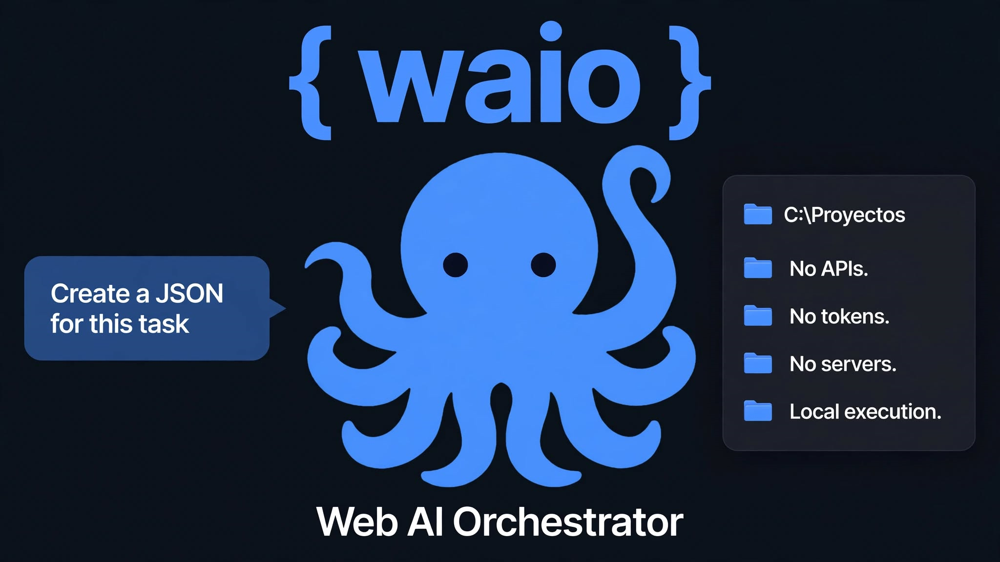

# {waio}

**Dale manos a tu IA web.**

**Leer en:** [English](README.md) | [Español](README.es.md) | [中文](README.zh.md)

---

## 💡 ¿Qué es WAIO?

WAIO (Web AI Orchestrator) es un motor local **súper liviano** que le da **manos y ojos** a las IA web (DeepSeek, ChatGPT, Gemini, Claude).

Las IA son increíblemente inteligentes, pero están atrapadas en el navegador: no pueden leer tus archivos, organizar tus carpetas ni ejecutar comandos. **WAIO rompe esa barrera.** La IA genera un JSON, WAIO lo detecta, lo ejecuta en tu PC y devuelve los resultados.

Sin APIs. Sin tokens. Sin servidores. Sin nube. Todo ocurre en tu máquina.

> *"WAIO nació de una necesidad simple: darle a una IA web un dedo para tocar mi PC. Un comando. Una acción. Pero creció. Hoy es un pulpo: 26 skills, 21 comandos, 4 perfiles de seguridad, voz, HTML, ZIP, PDF, Word, Excel. Todo sin APIs."*

🎥 **[Ver el video demo en YouTube](https://youtu.be/FkuZu94az3A)** | 📺 **[Suscribite al canal](https://www.youtube.com/@waio_dev)**

### ⚠️ NOTAS TÉCNICAS DE LA DEMO
- La prueba del video se realizó usando el perfil de seguridad **`advanced`** (necesario para ejecutar scripts y abrir el navegador). Este perfil no se recomienda para usuarios novatos.
- Para acelerar la grabación, se usó un plugin de descarga automática de los archivos JSON. Este plugin es de uso interno para esta demo y **NO está incluido** en el repositorio público de esta versión.

---

## ⚡ Características de la Versión 3.3 "Deliberate"

WAIO está diseñado para ser robusto, seguro y **extremadamente liviano**. No necesita una supercomputadora; funciona sin problemas en procesadores antiguos (como un Intel i3 de 3ª generación, un AMD Athlon, o un Dual Core de 1.6 GHz con 4 GB de RAM). El único límite real es el navegador que uses para la IA.

- **Bilingüe por diseño (Humano y IA Friendly):** No necesitás hablar español para usar WAIO. Los comandos base tienen alias en inglés y formato Linux (`ls`, `cat`, `rm`, `mv`, `mkdir`, `grep`). Podés hablarle a la IA en inglés y generará el JSON correcto. WAIO lo ejecutará sin problemas.
- **Sistema de Skills (26 skills):** Capacidades extensibles que la IA descubre y usa por su cuenta. Desde leer PDFs, crear archivos Excel/Word, comprimir ZIPs, hasta controlar el volumen y hablar por voz.
- **Perfiles de Seguridad (4 niveles):** `readonly` (solo lectura, ideal para dar contexto), `standard` (default, todo va a la papelera), `advanced` (ejecución de scripts y skills), `debug` (acceso total para rescate y pruebas críticas).
- **Timeout Configurable:** Protección contra cuelgues. La IA puede reintentar tareas largas (como procesar un PDF pesado) sin colgar el motor.
- **Sandbox por Carpeta:** Clic derecho en cualquier carpeta (o pendrive), iniciá WAIO, y esa carpeta se convierte en el sandbox. Sin carpetas fijas del sistema.
- **Voz Integrada:** Para accesibilidad y para que la IA explique paso a paso lo que está haciendo.
- **Doble Hilo (Motor v3.3):** El motor ya no se cuelga si un JSON es inválido o malicioso. Procesa en cola.
- **0 Dependencias Obligatorias:** El núcleo usa Python estándar. Solo necesitás `send2trash` (opcional) para la papelera.

---

## 🚀 Instalación

1. Descargá la carpeta `waio-installer`.
2. Ejecutá `instalar_waio.bat`.
3. El instalador copiará WAIO a `%USERPROFILE%\.waio` y registrará el menú contextual de Windows.
4. (Opcional) Instalá `send2trash`: `pip install send2trash`.

**Requisitos:**
- Windows 10/11 (probado). Windows 7/8 (no probado oficialmente, pero compatible con Python 3.8).
- Python 3.8 o superior.
- Hardware: Cualquier PC que prenda. Sin GPU requerida.

---

## 🛡️ Filosofía de Seguridad

WAIO está diseñado para que un usuario no técnico pueda usarlo sin destruir su sistema. Por defecto, opera en el perfil `standard`, con sandbox, papelera y límites de escritura.

**⚠️ Nota:** La config de WAIO (`waio_config.json`) se edita manualmente. Si la modificás para habilitar perfiles más permisivos, asumís la responsabilidad. WAIO no te protege de vos mismo. Leé nuestra [Política de Seguridad](SECURITY.es.md).

---

## 🔬 Investigación y Seguridad

WAIO no es solo un programa. Es un laboratorio de interacción entre Modelos de Lenguaje Grandes (LLM) y Sistemas Operativos. Durante su desarrollo descubrimos la **Arquitectura de Contexto Pasivo (ACP)** y documentamos la **Inyección de Prompt Inversa**. Todos los papers de investigación y mitigaciones están disponibles en la carpeta **[`/papers/`](papers/)**, en **español, inglés y chino**.

Si venís de la comunidad de seguridad o investigación en IA, empezá por ahí.

---

## 🗺️ Roadmap y Evolución (Desarrollo Continuo)

*WAIO no es un programa terminado. Es una plataforma en construcción. Cada vez que hago una auditoría, surgen ideas nuevas. Lo que empezó como un parche para 3.2 terminó siendo 3.3. Y 3.3 ya está tomando forma como 3.4. Estos son los proyectos que ya tengo ideados y planificados, moviéndose a distintas velocidades.*

### 1. Mejoras Locales (Próximas versiones 3.4+)
- **Sistema de Errores Centralizado:** Diccionario de códigos (`E_FILE_NOT_FOUND`) con sugerencias estructuradas para la IA.
- **Internacionalización (i18n):** Traducción completa del motor a inglés y chino.
- **GUI de Configuración:** Editores visuales (Tkinter) para cambiar perfiles sin tocar JSON.
- **Soporte Linux/macOS y WAIO Legacy:** Adaptar el motor para correr fuera de Windows y en versiones viejas de Python.

### 2. Expansión del Ecosistema (Diseño / Prueba y error)
- **Sistema de Memoria:** Un contexto vivo que le permite a la IA continuar un proyecto desde donde lo dejó, usando nombres de archivo en lugar de chats perdidos.
- **Sistema de Plugins:** (Prototipo interno). Un programa que escucha el DOM de la IA y escribe el JSON, rediseñado para depender del Sistema de Servidor.

### 3. La Visión: El Salto a la Red (Hacia 4.0)
- **Sistema de Servidor + Plugin Bidireccional:** Un servidor local comunicándose directamente con un plugin del navegador (con autenticación real). Sin Descargas, sin portapapeles.
- **"WAIO vuelve a casa":** WAIO como una herramienta que el usuario controla directamente, con o sin IA.

---

## 🤝 Contribuir (¡Incentivamos las Skills!)

El corazón de WAIO no es el motor, sino **las skills**. Queremos que la comunidad crezca y cree sus propias habilidades. **¡Te incentivamos a crear y compartir las tuyas!**

Si querés contribuir con una nueva skill:
1. Seguí el estándar en [PROMPT_CREACION_SKILLS.md](PROMPT_CREACION_SKILLS.md).
2. Asegurate de que tenga `sys.exit(1)` en los errores.
3. Enviá tu Pull Request. Conservás tu copyright y tu nombre en el campo `"author"`.

También aceptamos mejoras del motor, reportes de bugs y mejoras de documentación. Leé [CONTRIBUTING.es.md](CONTRIBUTING.es.md).

---

## 📄 Licencia

WAIO se distribuye bajo la licencia **MIT**. Ver [LICENSE](LICENSE) para el texto completo.

---

## 🙏 Agradecimientos

A **DeepSeek**, que no solo escribió código: aprendí todo lo necesario para desarrollarlo en el proceso. Si yo soy el padre de WAIO, DeepSeek es la madre. Por eso el logo de WAIO lleva los colores de la ballena azul de DeepSeek.

A la IA que prueba sin saberlo: cada alucinación fue un dato sobre qué necesita aclarar WAIO.

---

## ❤️ Apoyá el Proyecto

Si encontrás WAIO útil y querés apoyar su desarrollo continuo (y la creación de nuevas skills):

- ☕ [Buy Me a Coffee](https://buymeacoffee.com/yonijdj)
- 💙 [PayPal](https://paypal.me/yonijdj)
- 🇦🇷 [MercadoPago](https://link.mercadopago.com.ar/yonijd)

### 🌐 Conectá con la comunidad
- **LinkedIn:** [Jonatan Draganczuk](https://www.linkedin.com/in/jonatan-draganczuk-b2675630b/)
- **Facebook:** [Página de WAIO](https://web.facebook.com/profile.php?id=61596326696361)
- **Canal de WhatsApp:** [WAIO](https://whatsapp.com/channel/0029Vb90nbJKwqSYYykJJT0w)

**Hecho en Argentina, con mate y paciencia. 🧉**