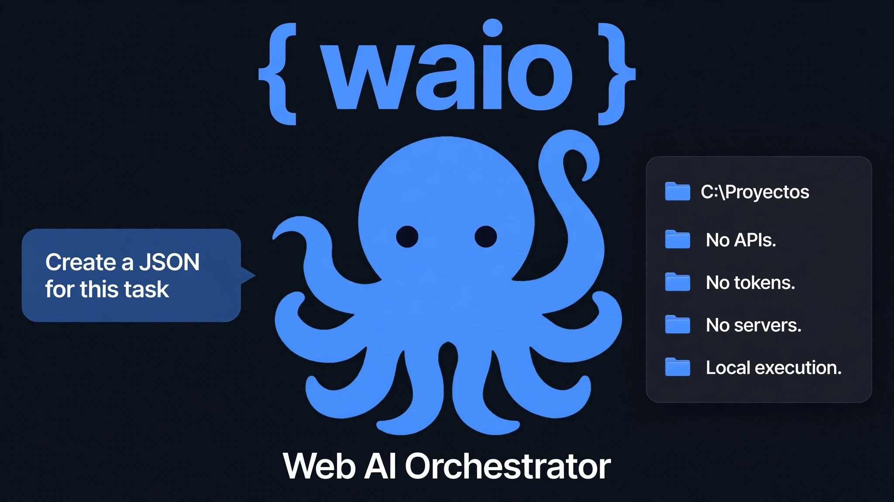

# {waio}

**给网页AI一双手。**

**阅读语言:** [English](README.md) | [Español](README.es.md) | [中文](README.zh.md)

---

## 💡 什么是 WAIO？

WAIO（Web AI Orchestrator）是一个**超轻量级**本地引擎，为网页 AI（DeepSeek、ChatGPT、Gemini、Claude）赋予**双手和眼睛**。

AI 非常聪明，但它们被困在浏览器中：无法读取你的文件、整理你的文件夹或执行命令。**WAIO 打破了这一障碍。** AI 生成 JSON，WAIO 检测到它，在你的电脑上执行，并返回结果。

无需 API。无需 Token。无需服务器。无需云端。一切都在你的机器上进行。

> *"WAIO 诞生于一个简单的需求：给网页 AI 一根手指去触摸我的电脑。一个命令。一个动作。但它成长了。今天它是一个章鱼：26 项技能、21 个命令、4 种安全配置文件、语音、HTML、ZIP、PDF、Word、Excel。全部无需 API。"*

🎥 **[在 YouTube 观看演示视频](https://youtu.be/FkuZu94az3A)** | 📺 **[订阅频道](https://www.youtube.com/@waio_dev)**

### ⚠️ 演示技术说明
- 视频测试使用了 **`advanced`** 安全配置文件（执行脚本和打开浏览器所必需）。此配置文件不建议新手用户使用。
- 为加快录制速度，使用了自动下载 JSON 文件的插件。此插件仅供本次演示内部使用，**不包含**在此版本的公共仓库中。

---

## ⚡ v3.3 "Deliberate" 版本特性

WAIO 设计为健壮、安全且**极其轻量**。它不需要超级计算机；在老旧处理器上也能流畅运行（如第三代 Intel i3、AMD Athlon 或 1.6 GHz 双核 4 GB RAM）。唯一真正的限制是你用于 AI 的浏览器。

- **双语设计（人类和 AI 友好）：** 你不需要会说西班牙语就能使用 WAIO。基础命令有英语和 Linux 格式的别名（`ls`、`cat`、`rm`、`mv`、`mkdir`、`grep`）。你可以用英语与 AI 交流，它会生成正确的 JSON。WAIO 将无缝执行。
- **技能系统（26 项技能）：** AI 自行发现和使用的可扩展能力。从读取 PDF、创建 Excel/Word 文件、压缩 ZIP，到控制音量和语音播报。
- **安全配置文件（4 个级别）：** `readonly`（只读，适合提供上下文）、`standard`（默认，一切进入回收站）、`advanced`（脚本和技能执行）、`debug`（完全访问，用于救援和关键测试）。
- **可配置超时：** 防止挂起。AI 可以重试长任务（如处理大型 PDF）而不会使引擎崩溃。
- **基于文件夹的沙盒：** 右键点击任何文件夹（或 U 盘），启动 WAIO，该文件夹即成为沙盒。没有固定的系统文件夹。
- **集成语音：** 用于无障碍访问，以及让 AI 逐步解释它正在做什么。
- **双线程（引擎 v3.3）：** 如果 JSON 无效或恶意，引擎不再挂起。它在队列中处理。
- **0 强制依赖：** 核心使用标准 Python。你只需要 `send2trash`（可选）用于回收站。

---

## 🚀 安装

1. 下载 `waio-installer` 文件夹。
2. 运行 `instalar_waio.bat`。
3. 安装程序将把 WAIO 复制到 `%USERPROFILE%\.waio` 并注册 Windows 上下文菜单。
4. （可选）安装 `send2trash`：`pip install send2trash`。

**要求：**
- Windows 10/11（已测试）。Windows 7/8（未正式测试，但与 Python 3.8 兼容）。
- Python 3.8 或更高版本。
- 硬件：任何能开机的电脑。无需 GPU。

---

## 🛡️ 安全理念

WAIO 的设计使非技术用户也能使用而不会破坏系统。默认情况下，它在 `standard` 配置文件中运行，带有沙盒、回收站和写入限制。

**⚠️ 注意：** WAIO 的配置（`waio_config.json`）是手动编辑的。如果你修改它以启用更宽松的配置文件，你需自行承担责任。WAIO 不保护你免受自己的伤害。请阅读我们的[安全政策](SECURITY.zh.md)。

---

## 🔬 研究与安全

WAIO 不仅仅是一个程序。它是大型语言模型（LLM）与操作系统交互的实验室。在开发过程中，我们发现了**被动上下文架构（PCA）**并记录了**反向提示词注入**。所有研究论文和缓解措施都位于 **[`/papers/`](papers/)** 文件夹，提供**西班牙语、英语和中文**版本。

如果您来自安全或人工智能研究社区，请从那里开始。

---

## 🗺️ 路线图与演进（持续开发）

*WAIO 不是一个完成的程序。它是一个正在建设中的平台。每次我进行审计，新想法就会出现。从 3.2 的补丁开始，最终成为 3.3。而 3.3 已经在向 3.4 发展。这些是我已经构思和规划的项目，以不同的速度推进。*

### 1. 本地改进（即将推出的 3.4+ 版本）
- **集中式错误系统：** 代码字典（`E_FILE_NOT_FOUND`），为 AI 提供结构化建议。
- **国际化（i18n）：** 引擎完整翻译为英语和中文。
- **配置 GUI：** 可视化编辑器（Tkinter），无需接触 JSON 即可更改配置文件。
- **Linux/macOS 支持与 WAIO Legacy：** 调整引擎以在 Windows 之外和旧版 Python 上运行。

### 2. 生态系统扩展（设计 / 试错）
- **记忆系统：** 一个活的上下文，允许 AI 从上次中断的地方继续项目，使用文件名而不是丢失的聊天记录。
- **插件系统：**（内部原型）。一个监听 AI DOM 并写入 JSON 的程序，重新设计为依赖服务器系统。

### 3. 愿景：向网络的飞跃（迈向 4.0）
- **服务器系统 + 双向插件：** 一个本地服务器直接与浏览器插件通信（具有真实身份验证）。无需下载，无需剪贴板。
- **"WAIO 回家"：** WAIO 作为用户直接控制的工具，无论是否有 AI。

---

## 🤝 贡献（我们激励技能！）

WAIO 的核心不是引擎，而是**技能**。我们希望社区成长并创造自己的能力。**我们激励你创造和分享你的技能！**

如果你想贡献新技能：
1. 遵循 [PROMPT_CREACION_SKILLS.md](PROMPT_CREACION_SKILLS.md) 中的标准。
2. 确保它在出错时有 `sys.exit(1)`。
3. 提交你的 Pull Request。你保留你的版权和 `"author"` 字段中的名字。

我们也接受引擎改进、错误报告和文档改进。请阅读 [CONTRIBUTING.md](CONTRIBUTING.md)。

---

## 📄 许可证

WAIO 在 **MIT** 许可证下分发。完整文本请参阅 [LICENSE](LICENSE)。

---

## 🙏 致谢

致 **DeepSeek**，它不仅仅写了代码：我在这个过程中学到了开发它所需的一切。如果我是 WAIO 的父亲，DeepSeek 就是母亲。这就是为什么 WAIO 的标志带有 DeepSeek 蓝鲸的颜色。

致那些在不知情中测试的 AI：每一次幻觉都是 WAIO 需要澄清的数据点。

---

## ❤️ 支持项目

如果你觉得 WAIO 有用，并希望支持它的持续开发（以及新技能的创建）：

- ☕ [Buy Me a Coffee](https://buymeacoffee.com/yonijdj)
- 💙 [PayPal](https://paypal.me/yonijdj)
- 🇦🇷 [MercadoPago](https://link.mercadopago.com.ar/yonijd)

### 🌐 与社区联系
- **LinkedIn:** [Jonatan Draganczuk](https://www.linkedin.com/in/jonatan-draganczuk-b2675630b/)
- **Facebook:** [WAIO 页面](https://web.facebook.com/profile.php?id=61596326696361)
- **WhatsApp 频道:** [WAIO](https://whatsapp.com/channel/0029Vb90nbJKwqSYYykJJT0w)

**阿根廷制造，带着马黛茶和耐心。 🧉**